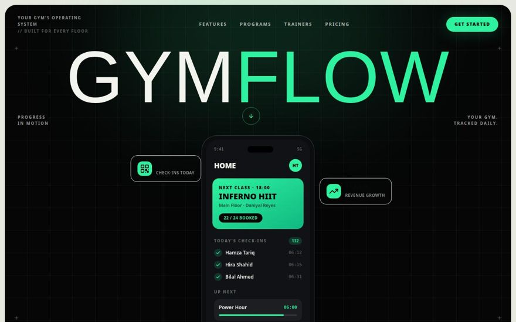
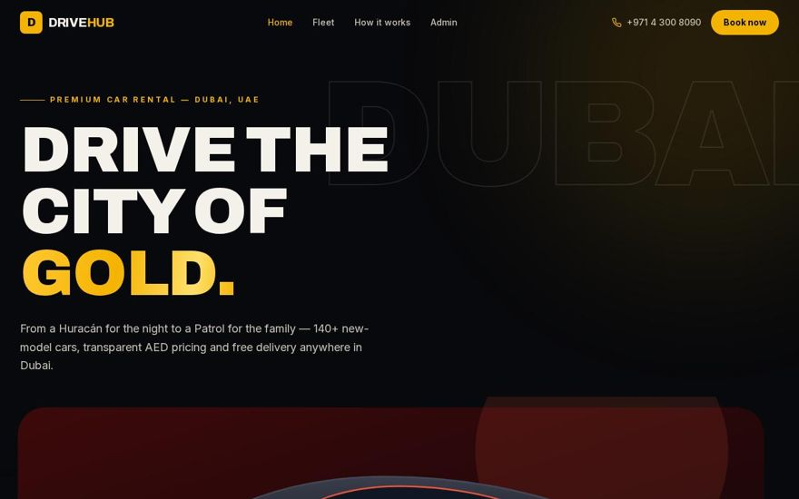
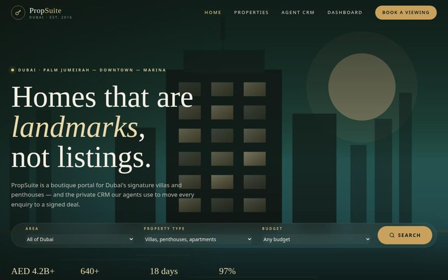
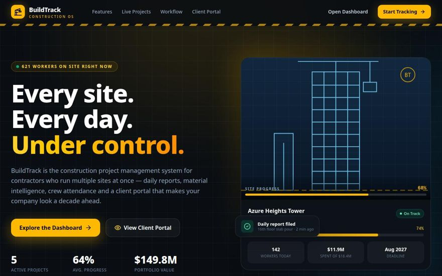
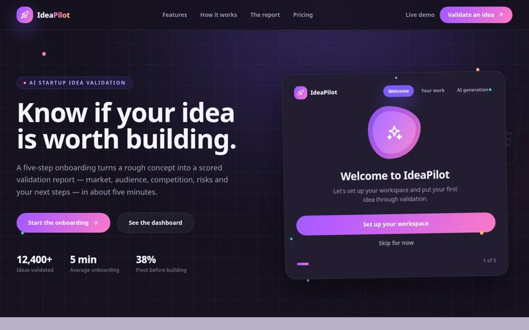
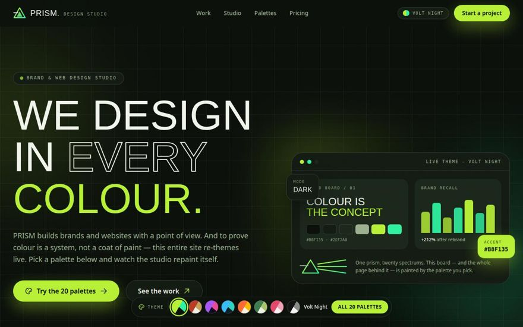

<div align="center">


</div>


```text
ali@github ~ $ ./whoami.sh

 █████╗ ██╗     ██╗
 ██╔══██╗██║     ██║
 ███████║██║     ██║
 ██╔══██║██║     ██║
 ██║  ██║███████╗██║
 ╚═╝  ╚═╝╚══════╝╚═╝

 > Ali Rizwan — Full-Stack Developer & AI Builder, Lahore, Pakistan
 > I design and ship complete products: landing pages that convert,
 >   SaaS dashboards, e-commerce and AI-powered web apps.
 > WordPress & WooCommerce specialist — now as a side service,
 >   full-stack + AI is the main act.
```

<div align="center">


</div>

## Featured work

<table>
  <tr>
    <td width="50%" valign="top">
      <a href="https://gymflow-one-omega.vercel.app"></a>
      <br /><br />
      <b><a href="https://github.com/alirizwan1231/gymflow">GymFlow</a></b> — Gym management SaaS: members, plans, attendance and a poster-grade analytics dashboard.
      <br /><a href="https://gymflow-one-omega.vercel.app">Live demo</a> · <a href="https://github.com/alirizwan1231/gymflow">Code</a>
    </td>
    <td width="50%" valign="top">
      <a href="https://drivehub-jade.vercel.app"></a>
      <br /><br />
      <b><a href="https://github.com/alirizwan1231/drivehub">DriveHub</a></b> — Dubai car-rental platform with a studio-style admin console and 360° fleet views.
      <br /><a href="https://drivehub-jade.vercel.app">Live demo</a> · <a href="https://github.com/alirizwan1231/drivehub">Code</a>
    </td>
  </tr>
  <tr>
    <td width="50%" valign="top">
      <a href="https://propsuite-beta.vercel.app"></a>
      <br /><br />
      <b><a href="https://github.com/alirizwan1231/propsuite">PropSuite</a></b> — Dubai real-estate portal + agent CRM: listings, leads and pipelines in one place.
      <br /><a href="https://propsuite-beta.vercel.app">Live demo</a> · <a href="https://github.com/alirizwan1231/propsuite">Code</a>
    </td>
    <td width="50%" valign="top">
      <a href="https://buildtrack-mauve-two.vercel.app"></a>
      <br /><br />
      <b><a href="https://github.com/alirizwan1231/buildtrack">BuildTrack</a></b> — Construction project OS: sites, tasks, materials and progress tracking.
      <br /><a href="https://buildtrack-mauve-two.vercel.app">Live demo</a> · <a href="https://github.com/alirizwan1231/buildtrack">Code</a>
    </td>
  </tr>
  <tr>
    <td width="50%" valign="top">
      <a href="https://ideapilot-two.vercel.app"></a>
      <br /><br />
      <b><a href="https://github.com/alirizwan1231/ideapilot">IdeaPilot</a></b> — AI startup-idea validation: a guided 6-step wizard that scores and stress-tests ideas.
      <br /><a href="https://ideapilot-two.vercel.app">Live demo</a> · <a href="https://github.com/alirizwan1231/ideapilot">Code</a>
    </td>
    <td width="50%" valign="top">
      <a href="https://prism-psi-sage.vercel.app"></a>
      <br /><br />
      <b><a href="https://github.com/alirizwan1231/prism">PRISM</a></b> — Brand & web studio site whose entire UI re-themes live from 20 curated colour palettes.
      <br /><a href="https://prism-psi-sage.vercel.app">Live demo</a> · <a href="https://github.com/alirizwan1231/prism">Code</a>
    </td>
  </tr>
</table>

**More builds:** [QuoteRevive](https://github.com/alirizwan1231/quoterevive) — dead-quote revival for contractors ([live](https://quoterevive-cyan.vercel.app)) · [NOIRÉ](https://github.com/alirizwan1231/noir-parfum) — real-time 3D glass perfume bottle ([live](https://noir-parfum-theta.vercel.app)) · [FlockCalc](https://github.com/alirizwan1231/flockcalc) — small-flock calculators ([flockcalc.site](https://flockcalc.site)) · [Load Option Generator](https://github.com/alirizwan1231/Load-option) — truck-dispatch load tickets ([live](https://load-option.vercel.app))

## Tech I ship with

<div align="center">


<br />


</div>

## GitHub stats

<div align="center">


<br />


</div>

## Contributions

<div align="center">

<picture>
  <source media="(prefers-color-scheme: dark)" srcset="https://raw.githubusercontent.com/alirizwan1231/alirizwan1231/output/snake-dark.svg" />
  <source media="(prefers-color-scheme: light)" srcset="https://raw.githubusercontent.com/alirizwan1231/alirizwan1231/output/snake-dark.svg" />
  
</picture>

</div>

## Connect

<div align="center">

<a href="mailto:alis5597153@gmail.com"></a>
<a href="https://www.instagram.com/Alirizwan3418"></a>
<a href="https://www.facebook.com/Alirizwan3418"></a>

<br /><br />


</div>


